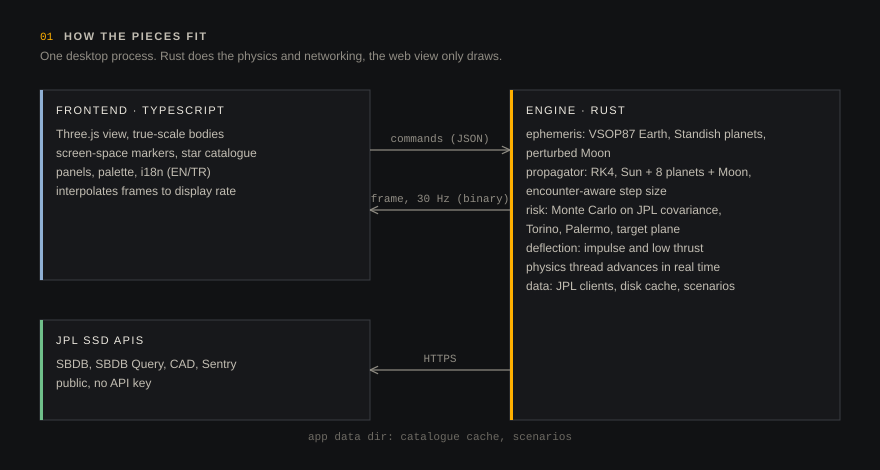

# CosmoRisk documentation

These pages explain how to use CosmoRisk and what it computes. They are written for curious users first and for people who want to check the physics second.

| Page | What's in it |
|---|---|
| [Getting started](getting-started.md) | First launch, loading data, the first ten minutes |
| [The interface](interface.md) | Every panel, keyboard shortcuts, settings |
| [Physics model](physics.md) | Ephemeris, force model, integrator, accuracy |
| [Impact risk](risk.md) | Flyby search, Monte Carlo, Torino and Palermo scales |
| [Deflection](deflection.md) | Kinetic impactor, ion beam, gravity tractor, target plane |
| [Data sources](data-sources.md) | JPL APIs, caching, offline use, scenarios |
| [Building](building.md) | Development setup, release process |
| [FAQ](faq.md) | Short answers |
| [Türkçe](tr/README.md) | Türkçe kısa kılavuz |

