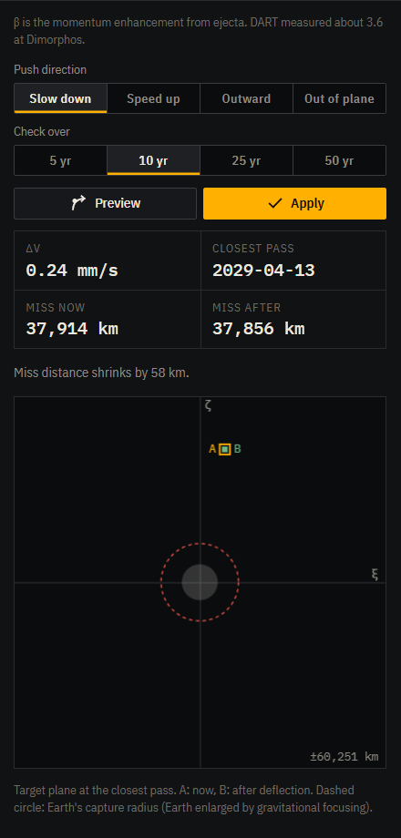
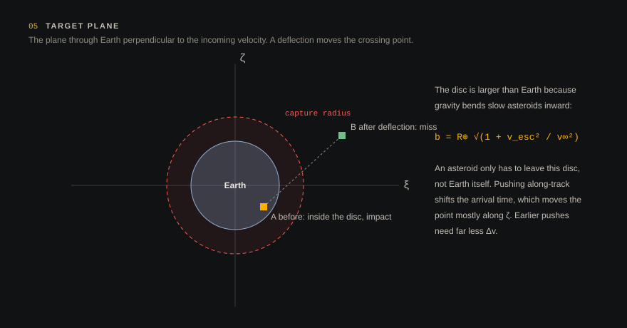

# Deflection

The planner in the inspector (section 06) answers one question: if we push this asteroid now, how much does its closest pass to Earth change?



## Methods

**Kinetic impactor.** A spacecraft hits the asteroid.

```
Δv = β · m_sc · v_imp / M
```

- β > 1 accounts for the extra momentum carried away by ejecta. NASA's DART mission measured β ≈ 3.6 at Dimorphos.
- The defaults are DART's own numbers: 580 kg at 6.1 km/s.

**Ion beam shepherd.** A spacecraft hovers nearby and points its ion exhaust at the asteroid. The acceleration is

```
a = η · F / M
```

applied continuously for the chosen number of days. η is the fraction of the beam momentum that is transferred.

**Gravity tractor.** A spacecraft hovers a fixed distance from the surface, and its gravity pulls the asteroid:

```
a = G · m_sc / d²
```

The force is tiny but very well controlled; it is a classic option for final trimming.

**Δv.** Enter the velocity change directly.

## Direction

The push is defined in the asteroid's own orbital frame:

- **Slow down / Speed up**: along the direction of motion. This is the most effective choice when there are years of warning. A change in speed changes the orbital period, so the arrival time at the encounter shifts by an amount that grows with every orbit.
- **Outward**: radial, away from the Sun.
- **Out of plane**: normal to the orbit.

## Preview and apply

**Preview** integrates two copies of the trajectory over the window, one untouched and one deflected. It then compares the closest Earth pass in each. Nothing changes in the simulation. **Apply** commits the change: a kinetic impulse acts immediately, while a low-thrust method keeps acting as the clock runs. The object turns green in the view.

You can always undo a deflection by reloading the object from JPL.

## Target plane



The plot under the preview shows the encounter as seen along the incoming direction (ξ, ζ coordinates). The dashed circle is Earth's capture radius:

```
b⊕ = R⊕ √(1 + v_esc² / v∞²)
```

This is larger than Earth itself, because gravity bends a slow asteroid inward. A deflection succeeds when the point leaves this circle, not Earth's physical disc.

## A worked example

Take Apophis, three years before its 2029 flyby, with a DART-like impactor slowing it down:

- Δv ≈ 0.24 mm/s (Apophis is about 4×10¹⁰ kg).
- The miss distance changes by about 58 km.

Pushing earlier, or with a heavier impactor, scales roughly linearly. This is why every deflection study says the same thing: the most important variable is warning time.
