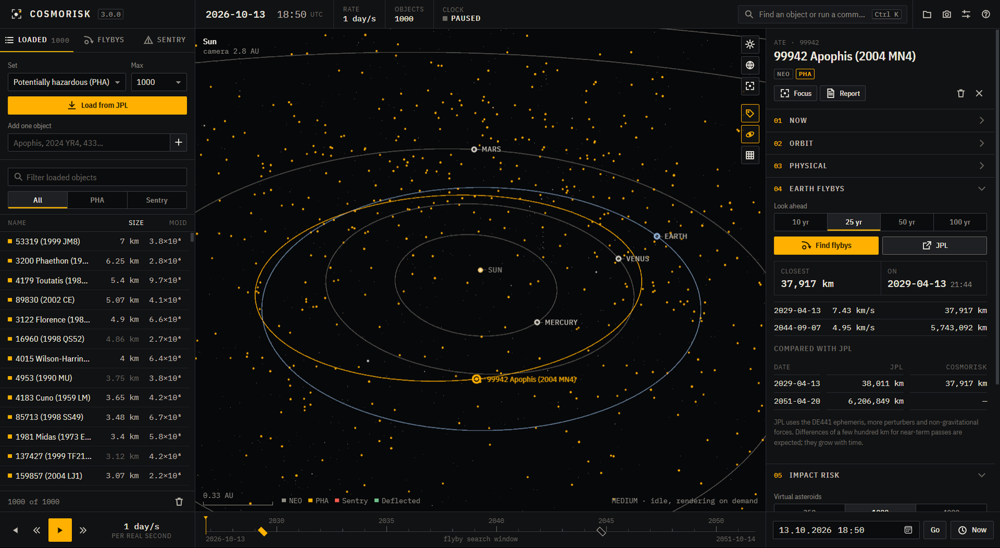

# Getting started

## First launch

The window opens on the inner Solar System, viewed from about 3 AU. You will see the Sun, the planets with their orbits, and real background stars. No asteroids are loaded yet. The first time, a short note offers to load the potentially hazardous asteroids (PHAs); you can say yes or do it later from the left panel.

You don't need an account or an API key. All data comes from public NASA/JPL services.

## Load something

In the left panel, under **Loaded**:

- **Set** chooses what to fetch:
  - *Potentially hazardous*: about 2,500 objects that come within 0.05 AU of Earth's orbit and are larger than roughly 140 m.
  - *NEOs larger than ~1 km*: the big ones.
  - *All NEOs, brightest first*: anything near Earth, largest first.
- **Max** caps the number of objects. A thousand is a good balance; 5,000 still runs smoothly on most machines.
- **Add one object** fetches a single body by name or designation, for example `Apophis`, `101955`, `2024 YR4` or `433`. This also downloads its orbit covariance, which the Monte Carlo uses.

The catalogue is saved to disk. The next time you start the app, it offers to restore the last set without going online.

## Look around

- Drag to rotate, scroll to zoom, and right-drag to pan.
- `1` looks at the Sun and `2` looks at Earth. `3` (or `F`) looks at the selected object.
- Click a dot to select it. Double-click it to select it and fly the camera to it.
- Dots are drawn at a fixed size on screen, because a 300 m asteroid seen from 1 AU is far smaller than a pixel. Planets get a ring marker until you are close enough to see the real sphere. Everything is drawn at true scale, so near Earth you can see the Moon's real orbit.

Colours: grey for an ordinary NEO, amber for a potentially hazardous one, red for objects on JPL's Sentry list, green for anything you have deflected.

## Run the clock

Space starts and stops time. `[` and `]` change the speed through these steps: real time, 1 minute, 1 hour, 6 hours, 1 day, 1 week, 1 month and 1 year per second. On keyboards where brackets are awkward, `−` and `+` work too. `R` reverses time and `N` jumps back to now.

You can also type a date in the field at the bottom right and press **Go**. Jumps of up to 60 years are integrated, so they keep any deflection you applied. Longer jumps re-place every object from its catalogue orbit.

## A first investigation

1. Press Ctrl K, type `apophis` and press Enter.
2. In the inspector, open **Earth flybys** and press **Find flybys**. You should see the 13 April 2029 pass at about 38,000 km.
3. Press **JPL** to fetch JPL's own close-approach list and compare the numbers.
4. Click the 2029 diamond on the timeline. The clock jumps to the day before the flyby. Press `2` to look at Earth, set the speed to 1 hour per second and run.

Next: [the interface](interface.md), or what the numbers mean in [impact risk](risk.md).
