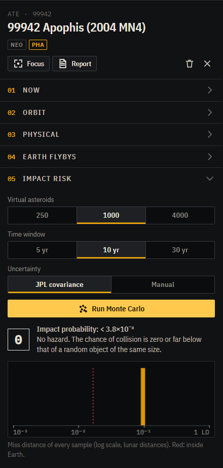
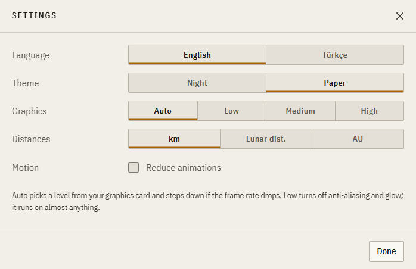
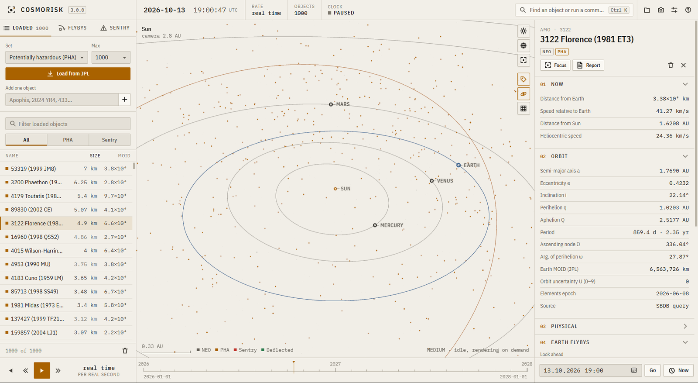

# The interface

The window has five areas:

- the top bar: clock and status
- the left rail: catalogue
- the 3D view in the middle
- the right rail: the inspector
- the bottom strip: time control

## Top bar

- **Clock.** The simulation date and time in UTC. Internally the engine runs on TDB, which is 69 seconds ahead; the conversion is automatic.
- **Rate.** Simulated time per real second.
- **Objects.** How many bodies are loaded.
- **Status.** Whether the clock is running.
- The search field opens the **command palette** (Ctrl K). It finds loaded objects by name and runs any command. If you type a designation that isn't loaded, it offers to fetch it from JPL.
- On the right are buttons for scenarios, saving a screenshot, settings and help.

## Left rail

**Loaded** lists every object in the simulation. You can sort by size or by Earth MOID (minimum orbit intersection distance), filter by name, or narrow to PHAs or Sentry objects. The filter also hides objects in the 3D view. The arrow keys move through the list and Enter flies to the selected object.

Diameters shown in grey are estimates. JPL has no measured diameter for those objects, so the size comes from the absolute magnitude H with an assumed albedo of 0.14. They can be off by a factor of two either way.

**Flybys** shows the close approaches to Earth in the next 30 days, 60 days or year, from JPL CAD. Click a row to load and select that object.

**Sentry** shows JPL's impact-monitoring list, sorted by cumulative Palermo scale. JPL's server is slow for this list, so the first fetch can take up to a minute. After that it is cached for a day.

## Inspector

Select an object and the inspector shows six numbered sections.

1. **Now**: distance and speed relative to Earth and to the Sun, updated live, plus any applied Δv or thrust.
2. **Orbit**: osculating elements computed from the current state. After a deflection or a close flyby they change. The Earth MOID and the orbit uncertainty parameter U are JPL's values.
3. **Physical**: diameter, H, albedo, spectral type, rotation period, and the density and mass used for impact energy.
4. **Earth flybys**: propagates forward 10–100 years and lists every pass within 0.05 AU. **JPL** puts JPL's own CAD numbers alongside for comparison.
5. **Impact risk**: Sentry's official numbers if the object is on the list, and our own Monte Carlo. See [impact risk](risk.md).
6. **Deflection**: the planner. See [deflection](deflection.md).

**Report** saves a Markdown file with everything shown for the object, including any analysis you have run.

## 3D view

The buttons on the right side of the view are:

- look at the Sun (`1`), Earth (`2`) or the selection (`3`)
- labels (`L`)
- planet orbits (`O`)
- an ecliptic grid with rings at 0.5, 1, 1.5, 2, 3, 5, 10, 20 and 30 AU (`G`)

At the bottom left, a scale bar shows a round distance for the current zoom. At the bottom right you can see the graphics tier, the frame rate and how long the last physics step took.

If an object hits Earth during a run, a red banner reports the time and speed and the object stops at the impact point.

## Timeline

From left to right:

- reverse
- slower
- run/pause
- faster
- the current rate
- a time axis
- a date field

After a flyby search, the axis spans the search window. Each pass appears as a diamond: amber for passes inside the Moon's distance, red for an impact. Clicking a diamond moves the clock to one day before that pass.

## Keyboard

| Key | Action |
|---|---|
| Space | Run / pause |
| `[` `]` or `−` `+` | Slower / faster |
| `R` | Reverse time |
| `N` | Jump to now, real-time rate |
| `1` `2` `3` | Look at Sun / Earth / selection |
| `F` | Focus the selection |
| `L` `O` `G` | Labels / planet orbits / grid |
| Ctrl K | Command palette |
| Esc | Close the dialog, or deselect |
| `?` | Help |

## Settings

- **Language**: English or Turkish.
- **Theme**: *Night* (dark), or *Paper*, a light theme that draws the sky as a printed star chart.
- **Graphics**:
  - *Auto* picks a tier from your GPU and steps down if the frame rate stays under 45 fps.
  - *Low* has no anti-aliasing or glow and renders at device pixel ratio 1.
  - *Medium* adds 4× multisampling.
  - *High* adds a subtle bloom and full pixel ratio.
- **Distances**: km, lunar distances (LD, 384,400 km) or AU.
- **Reduce animations**: turns off motion in panels and the camera. This is also enabled automatically if your system asks for reduced motion.

