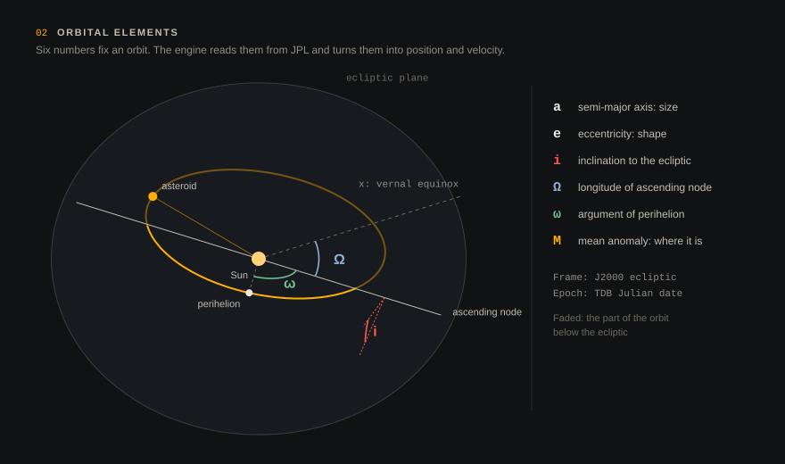

# Physics model

This page describes what the engine (`src-tauri/src/physics/`) actually computes, and how far you can trust it.

## Units and frame

- Inside the engine, distances are in AU, times are TDB Julian dates in days, and velocities are in AU/day.
- The frame is heliocentric, ecliptic and equinox J2000, the same frame JPL uses for small-body elements.
- GM of the Sun is the square of the Gaussian constant (k = 0.01720209895).
- Planetary masses are IAU/DE430 mass ratios.



## Where the planets are

| Body | Model | Typical error |
|---|---|---|
| Earth | VSOP87B, truncated at amplitude 10⁻⁸ (648 terms) | < 1″, a few hundred km |
| Mercury … Neptune | JPL *Keplerian elements for approximate positions*, table 1 (1800–2050) | arcseconds to tens of arcseconds |
| Moon | Mean elements with the main periodic terms (evection, variation, annual equation, …) | ~0.1–0.3° |

Earth gets the most accurate model because close-approach geometry depends on it more than on anything else. Inside a propagation the engine first tabulates all nine positions every 0.25 days and then interpolates them with a cubic. The interpolation adds less than 1 km of error for Earth and the Moon, and it is many times faster than solving Kepler's equation at every integrator stage.

## Force model

An asteroid is treated as a massless particle. Its acceleration is

```
a = −GM☉ r/|r|³ + Σ GMⱼ [ (rⱼ − r)/|rⱼ − r|³ − rⱼ/|rⱼ|³ ]
```

The sum runs over Mercury to Neptune plus the Moon, with Earth and the Moon as separate bodies. The second term inside the bracket is the *indirect term*: the frame is centred on the Sun rather than the barycentre, and leaving the term out would wrongly drag asteroids toward Jupiter.

Not modelled:

- the Yarkovsky effect and other non-gravitational forces
- general relativity (about 3″ per century for an Earth-like orbit)
- perturbations by large asteroids
- Earth's oblateness (J2)

For most objects these matter only over decades, or during very deep encounters.

## Integrator

Classical fourth-order Runge–Kutta, with a step size chosen from the local time scales:

- a fiftieth of the heliocentric dynamical time `r^1.5 / k`
- within 0.2 AU of Earth or the Moon, a fortieth of the shorter of the crossing time `d / v_rel` and the free-fall time `√(d³/GM)`
- the free-fall time of every other planet

The step is clamped between 0.1 s and 2 days. During the Apophis flyby, for example, steps drop to about 20 seconds, and in quiet interplanetary space they are around a day. The engine propagates time backwards with the same scheme.

Tests in `src-tauri/src/physics/` check:

- Kepler's equation for eccentricities up to 0.999
- the round trip between elements and state vector
- energy conservation over a year in a pure two-body case (better than 10⁻⁸)
- Earth's position at J2000 against JPL Horizons
- the 2029 Apophis flyby: date within 0.01 day, distance within 1,500 km, v_rel within 0.1 km/s of JPL CAD (it actually lands within about 100 km)

## From catalogue to simulation

JPL gives osculating elements at an epoch, usually a few months from today. When an object is loaded, its state at the epoch is computed exactly and then integrated, with perturbations, to the simulation date. If the epoch is more than 800 days away, two-body motion is used to place it instead.

The simulation clock runs in a background thread. Each display frame it advances every object by `rate × elapsed time`, in parallel across CPU cores. The renderer reads a compact binary snapshot about 30 times a second and interpolates between snapshots, so motion stays smooth at any refresh rate.

## Close encounters and impacts

Within each integrator step, the minimum distance to Earth is found by treating the relative motion as a straight line. Steps near Earth are short, so this is accurate to metres. If the minimum is below Earth's radius (6,378 km), the object is marked as impacted, pinned to the impact point, and an event is shown.

The flyby search reports every local minimum below 0.05 AU. For each one it gives:

- the time and distance
- the geocentric speed
- the hyperbolic excess speed v∞
- an approximate position on the target plane (see [deflection](deflection.md))

## How close to JPL?

For near-term passes the agreement is a few hundred km or better, as with Apophis 2029. Two things widen the gap with time:

1. **Chaos.** A deep encounter magnifies every small difference. After Apophis passes inside the geostationary ring in 2029, the 2044 and 2051 passes in CosmoRisk differ from JPL's by millions of km. That is expected, and JPL's own uncertainty grows similarly.
2. **Missing forces.** For Apophis the Yarkovsky drift alone is a few hundred km by 2029.

In short, read results more than a decade or two past a deep encounter as illustrative, not predictive.
