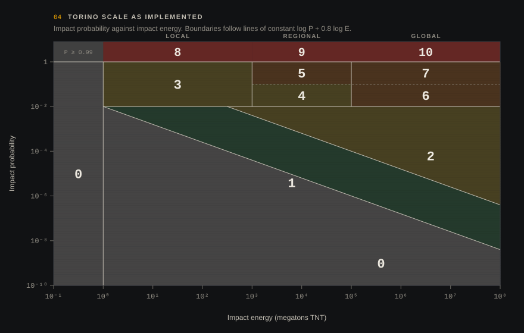

# Impact risk

CosmoRisk shows two kinds of risk numbers, and keeps them apart on purpose:

- **JPL Sentry**: the official assessment, computed by JPL's monitoring system. If an object is on the Sentry list, the inspector shows its cumulative impact probability, cumulative Palermo scale, maximum Torino scale and the most likely date. These are the numbers to quote.
- **CosmoRisk Monte Carlo**: our own estimate, computed on your machine. It is useful for learning, for objects you have deflected, and for checking that the model behaves.

## Monte Carlo


1. **Virtual asteroids.** The engine draws N orbits consistent with the observations.
   - *JPL covariance* mode samples the 6×6 covariance of (e, q, tp, Ω, ω, i) published in the SBDB with a Cholesky factorisation. That is the actual uncertainty of the orbit fit. If the object was loaded as part of a catalogue set, the covariance is fetched on demand.
   - *Manual* mode adds isotropic Gaussian noise of a chosen size to the current position and velocity.
2. **Shift to today.** The samples live at the covariance epoch. Each one is integrated to the current simulation date, and then shifted by the difference between the simulated object and the nominal orbit. That way any deflection you applied is carried into every sample.
3. **Propagate.** Every sample is integrated through the chosen window (5, 10 or 30 years) with the full force model, in parallel. A sample counts as an impact if it comes within Earth's radius. Gravitational focusing is included automatically, because Earth's gravity is in the force model.
4. **Report.**
   - P = impacts / N, with a 95 % Wilson interval.
   - The closest and median miss distance.
   - A log-scale histogram of every sample's closest approach.

A note on small numbers: with 1,000 samples and no hits, the honest statement is "P is probably below 4×10⁻³", not "P = 0". The panel says so. Real Sentry probabilities are often 10⁻⁶ or smaller, far beyond what a few thousand samples can resolve. JPL uses smarter methods (line-of-variations sampling) for that reason.

## Impact energy

```
E = ½ m v_imp²,   v_imp = √(v∞² + v_esc²),   v_esc = 11.19 km/s
```

The mass comes from the diameter, assuming a sphere. The density depends on the spectral type:

| Spectral type | Density |
|---|---|
| C, B, G, F | 1,400 kg/m³ |
| D, P, T | 1,200 kg/m³ |
| S, Q, K, L, A, R | 2,600 kg/m³ |
| V | 3,200 kg/m³ |
| M | 4,500 kg/m³ |
| unknown | 2,000 kg/m³ |

v∞ is taken from the nominal closest approach. Energy is reported in megatons of TNT (4.184×10¹⁵ J).

## Palermo scale

```
PS = log₁₀( P / (f_B · T) ),   f_B = 0.03 · E^−0.8 per year
```

- f_B is the background impact frequency for events at least as energetic (Chesley et al. 2002).
- T is the time until the potential impact, in years.
- PS = 0 means the event is as likely as the background over the same period.
- PS = −2 means it is a hundred times less likely.

## Torino scale

The Torino scale (Binzel 2000, revised by Morrison et al. 2004) is defined as a chart, not a formula. The chart below is our digitisation, drawn straight from the function in `src-tauri/src/physics/risk.rs`:



- Energy classes: *local* below 10³ Mt, *regional* below 10⁵ Mt, *global* above.
- P ≥ 0.99 gives levels 8, 9 or 10, depending on the energy class.
- 0.01 ≤ P < 0.99 gives level 3 (local), 4 or 5 (regional) and 6 or 7 (global). The higher level of each pair applies above P = 0.1.
- Below 1 %, the diagonals follow lines of constant log P + 0.8 log E, the same slope as the Palermo background. Below −2 the level is 0, between −2 and 0 it is 1, and above 0 it is 2.
- Anything under 1 Mt is 0.

Levels near the boundaries can differ by one from JPL's assignment. Use the Sentry value when it exists.
