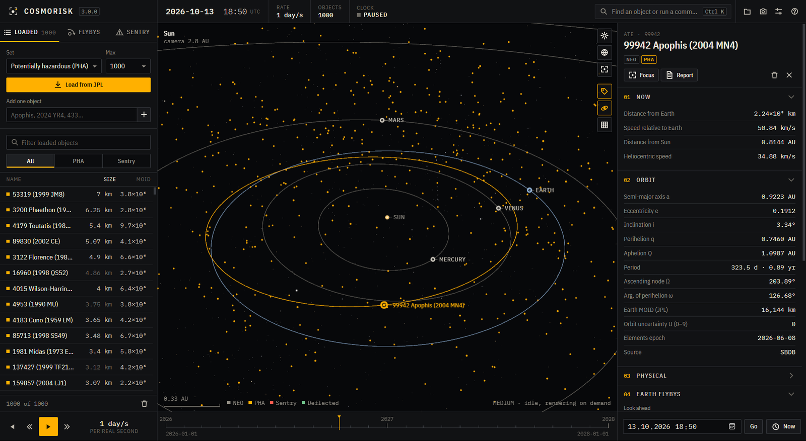
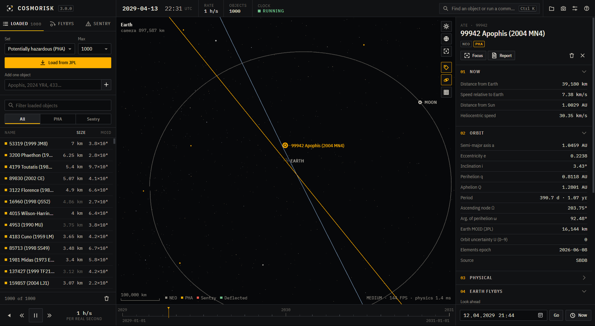

# CosmoRisk: Türkçe kılavuz

CosmoRisk, Dünya'ya yakın asteroitler için yazdığım bir masaüstü simülatörü. NASA/JPL'den gerçek yörüngeleri alıyor; onları Güneş, gezegenler ve Ay'ın kütle çekimiyle ilerletiyor; Dünya'nın yanından ne zaman geçeceklerini buluyor, çarpma olasılığını hesaplıyor ve birini yolundan çevirmeyi denemenizi sağlıyor.

## Başlarken

1. Sol panelde **Küme** olarak *Potansiyel tehlikeli (PHA)* seçiliyken **JPL'den yükle**'ye basın. API anahtarı gerekmez.
2. Görünümde bir noktaya tıklayın ya da Ctrl K ile komut paletini açıp bir ad yazın, örneğin `apophis`.
3. Sağdaki inceleme panelinde:
   - **Geçişleri bul**: önümüzdeki yakın geçişleri listeler. **JPL** düğmesi, JPL'nin kendi değerlerini yan yana koyar.
   - **Monte Carlo çalıştır**: JPL'nin yörünge kovaryansından örnekleyerek çarpma olasılığını hesaplar.
   - **Saptırma → Önizle**: bir itmenin en yakın geçişi nasıl değiştireceğini gösterir.
4. Boşluk tuşu saati çalıştırır. Hız `[` `]` ile değişir; Türkçe klavyede `−` `+` daha rahattır.

Yüklenen katalog diske kaydedilir. Bir sonraki açılışta internet olmadan geri yüklenebilir.

## Doğruluk

Motorun 2029 Apophis geçişi için verdiği sonuç, JPL'nin çözümüyle neredeyse aynı:

| 99942 Apophis, 2029 | JPL CAD | CosmoRisk 3 |
|---|---:|---:|
| En yakın an (UTC) | 2029-04-13 21:46 | 2029-04-13 21:44 |
| Dünya merkezine uzaklık | 38.011 km | 37.917 km |
| Göreli hız | 7,42 km/s | 7,43 km/s |

Model şu kaynaklara dayanıyor:

- **Dünya:** VSOP87.
- **Diğer gezegenler:** JPL'nin yaklaşık Kepler elemanları.
- **Ay:** bozulmalı bir Ay kuramı.
- **Asteroitler:** Güneş, sekiz gezegen ve Ay'ın etkisi altında RK4 ile ilerletiliyor.

Yarkovsky gibi yerçekimi dışı kuvvetler modellenmiyor. Derin bir yakın geçişten on yıllar sonrası için sonuçlar yol göstericidir, kesin değildir. Ayrıntılar [physics.md](../physics.md) sayfasında.

## Risk ölçekleri

- **Sentry**: JPL'nin resmî değerlendirmesi. Bir cisim listede varsa, inceleme panelinde JPL'nin hesapladığı olasılık, Palermo ve Torino değerleri gösterilir. Alıntılanacak rakamlar bunlardır.
- **Monte Carlo**: bilgisayarınızda yapılan kendi tahminimiz. Sıfır çarpma çıkması "olasılık sıfır" demek değildir; panel %95 güven aralığının üst sınırını gösterir.
- **Torino ve Palermo**: hesapları ve Torino sınırlarının çizimi [risk.md](../risk.md) sayfasında.

## Klavye

| Tuş | İşlev |
|---|---|
| Boşluk | Çalıştır / duraklat |
| `[` `]` ya da `−` `+` | Yavaşlat / hızlandır |
| `R` | Zamanı geri sar |
| `N` | Şimdiye dön |
| `1` `2` `3` | Güneş / Dünya / seçili cisim |
| `L` `O` `G` | Etiketler / yörüngeler / ızgara |
| Ctrl K | Komut paleti |
| Esc | Pencereyi kapat ya da seçimi bırak |

## Ayarlar

- **Dil:** İngilizce ya da Türkçe.
- **Tema:** *Gece* ya da *Kâğıt*. Kâğıt teması gökyüzünü basılı bir yıldız haritası gibi çizer.
- **Grafik:** *Otomatik* ekran kartınıza göre bir seviye seçer, kare hızı düşerse kaliteyi kendiliğinden indirir. *Düşük* neredeyse her makinede akıcı çalışır.
- **Uzaklık birimi:** km, Ay uzaklığı ya da AU.

Diğer belgeler (İngilizce): [arayüz](../interface.md), [fizik](../physics.md), [risk](../risk.md), [saptırma](../deflection.md), [veri kaynakları](../data-sources.md), [derleme](../building.md).
